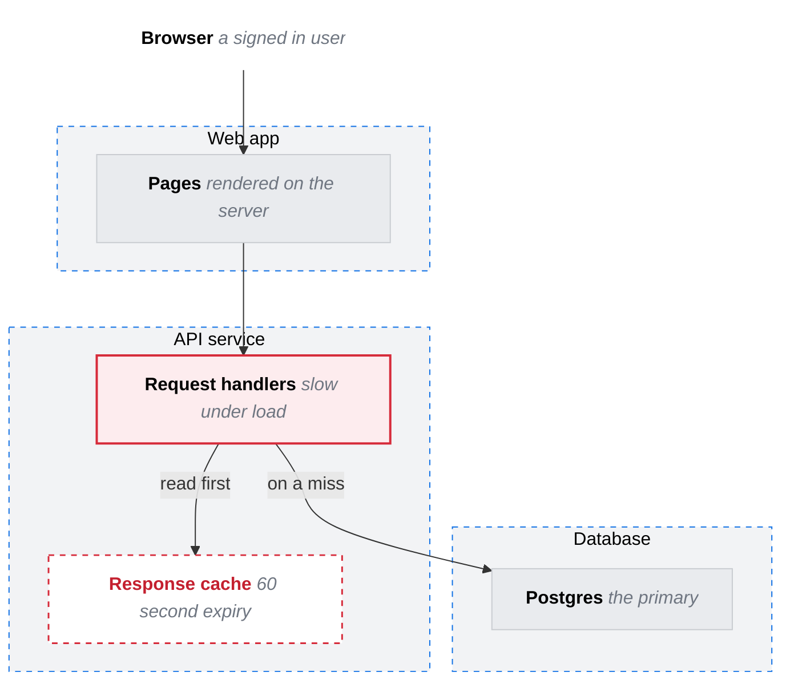

# Infra

Systems as frames, their parts inside, the context (users, outside services) as plain boxes. Edges carry what flows between them.

Legend: grey works today and stays, red outline is broken today, red dashed outline is still to build.
