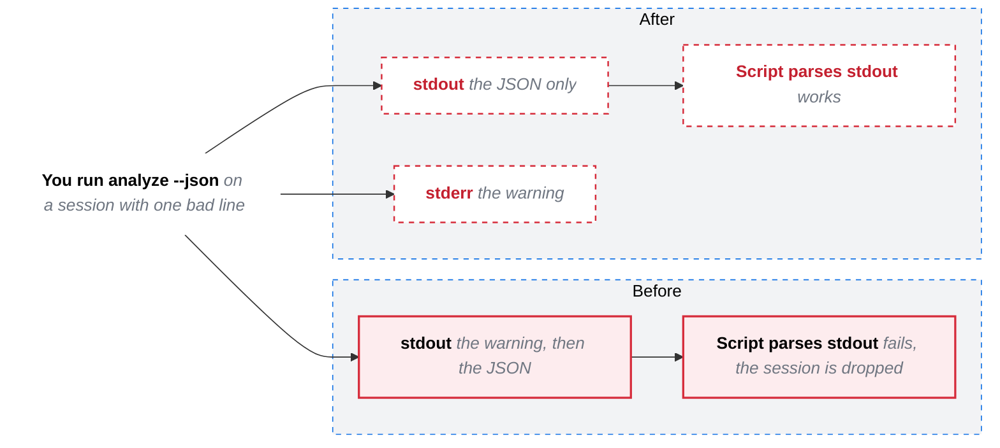
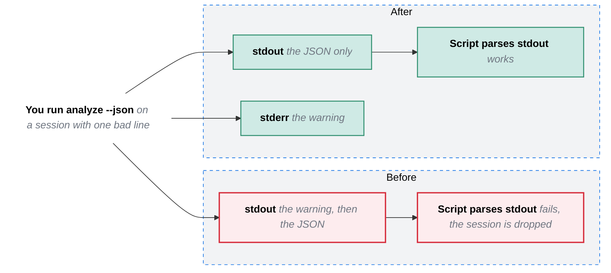

# Software change

A real bug from an open source CLI: `analyze --json` printed parser warnings to stdout before the JSON, so a script that parses stdout dropped the session. Two frames, Before and After, with the same steps in each.

## In the issue, under Picture

Legend: red outline is broken today, red dashed outline is still to build.

## In the PR, under After

The same picture, drawn from the diff. What the PR built turns green.

Legend: red outline was broken before this PR, green is new or fixed by it.
