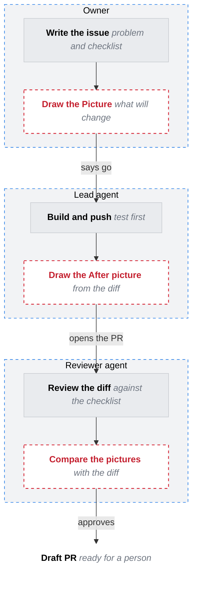

# Workflow

Who does what, in order, and where the work changes hands. One frame per person or agent, steps inside, edges in the order things happen. Label a hand off on its edge. A chain this long runs top to bottom, or GitHub shrinks it to fit.

Legend: grey works today and stays, red dashed outline is still to build.
